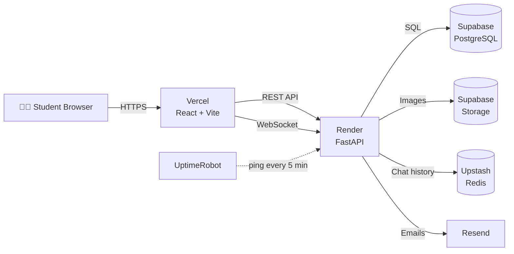
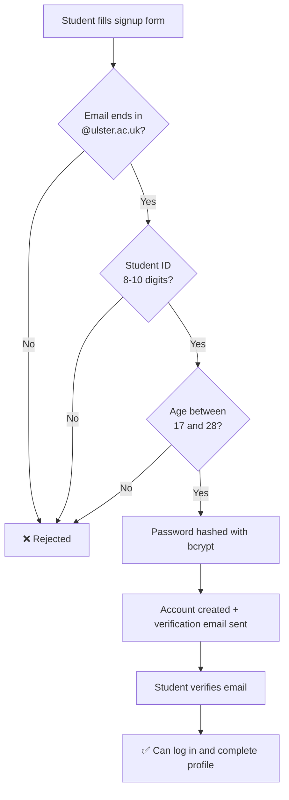
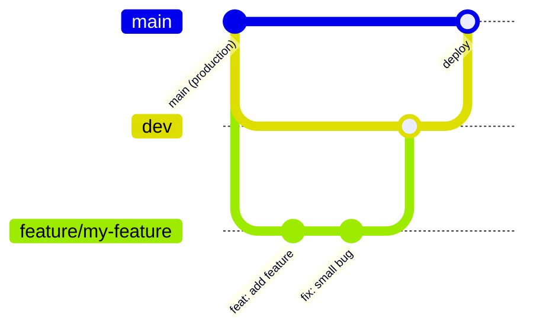

<div align="center">

# 🎓 UniPulse

### A private social network built exclusively for Ulster University students.

No algorithm. No ads. No AI content. No spam. Just verified students.

[](https://unipulse.xyz)


</div>

---

## 📖 Table of Contents

- [About](#-about)
- [Screenshots](#-screenshots)
- [Features](#-features)
- [How Verification Works](#-how-verification-works)
- [Tech Stack](#-tech-stack)
- [Architecture](#-architecture)
- [Project Structure](#-project-structure)
- [Getting Started](#-getting-started)
- [Environment Variables](#-environment-variables)
- [API Overview](#-api-overview)
- [Real-Time Chat Events](#-real-time-chat-events)
- [Deployment](#-deployment)
- [Git Workflow](#-git-workflow)
- [Roadmap](#-roadmap)
- [Author](#-author)

---

## 💡 About

UniPulse is a clean, simple social network made only for **Ulster University students**. Most social platforms are noisy: algorithms decide what you see, ads follow you around, and bots fill the feed. UniPulse is the opposite. You see posts from real, verified students in the order they were posted, and that's it.

---

## 📸 Screenshots

> Add your screenshots to a `docs/screenshots/` folder and update the file names below.

| Home Feed | Global Chat |
|:---:|:---:|
|  |  |

| Private Messages | Profile |
|:---:|:---:|
|  |  |

---

## ✨ Features

| Feature | Description |
|---|---|
| 🔐 **Verified signup** | Only real Ulster students can join (three checks, see below) |
| 📰 **Home feed** | Chronological feed with infinite scroll, no algorithm |
| ✍️ **Posts with images** | Share text and photos, stored in Supabase Storage |
| ❤️ **Likes** | Like posts and see like counts |
| 👥 **Friends** | Send, accept and remove friend requests |
| 💬 **Global chat** | Real-time chat open to all students (last 100 messages kept) |
| ✉️ **Private messages** | One-to-one real-time DMs with message history |
| 🔔 **Notifications** | Friend requests, accepted requests and new messages |
| 🔎 **Search** | Find students and courses |
| 👤 **Profiles** | Profile page with picture, name and course |
| 🔑 **Password tools** | Forgot password, reset password and change password |

---

## 🛡️ How Verification Works

To create an account, **all three** checks must pass:

| # | Check | Rule |
|---|---|---|
| 1 | **Email** | Must end in `@ulster.ac.uk` |
| 2 | **Student ID** | 8 to 10 digits (example: `20001780`) |
| 3 | **Date of birth** | Age must be between **17 and 28** |

Passwords are hashed with **bcrypt** and sessions use **JWT tokens** that expire after 24 hours.

---

## 🧰 Tech Stack

| Layer | Technology |
|---|---|
| **Frontend** | React + TypeScript, Tailwind CSS, Vite |
| **Backend** | Python 3.11, FastAPI |
| **Database** | PostgreSQL (Supabase) |
| **Real-time** | Socket.io + Redis (Upstash) |
| **File storage** | Supabase Storage |
| **Auth** | JWT (24h expiry), bcrypt |
| **Email** | Resend |
| **Hosting** | Vercel (frontend), Render (backend) |
| **Domain** | unipulse.xyz (Namecheap) |
| **Monitoring** | UptimeRobot |

---

## 🏗️ Architecture



### Signup and verification flow



---

## 📁 Project Structure

```
unipulse/
├── frontend/
│   ├── vercel.json              # SPA routing rewrites
│   ├── tsconfig.app.json
│   └── src/
│       ├── components/
│       │   └── Navbar.tsx
│       ├── pages/               # Landing, Login, Signup, Home, Profile,
│       │                        # Search, GlobalChat, PrivateChat, Settings...
│       └── utils/
│           ├── api.ts           # API client (uses VITE_API_URL)
│           └── auth.ts
├── backend/
│   ├── .python-version          # Python 3.11
│   ├── requirements.txt         # Used by Render
│   └── app/
│       ├── main.py              # FastAPI app + Socket.io mount
│       ├── database.py          # SQLAlchemy engine and session
│       ├── models/
│       ├── schemas/
│       ├── utils/
│       │   └── auth.py          # JWT helpers
│       └── routers/
│           ├── auth.py          # Signup, login, passwords
│           ├── users.py
│           ├── posts.py
│           ├── likes.py
│           ├── friends.py
│           ├── notifications.py
│           ├── messages.py
│           ├── search.py
│           ├── live_status.py
│           └── chat.py          # Socket.io real-time chat
├── requirements.txt             # Root copy, kept for reference
└── start.py                     # Starts frontend and backend together
```

---

## 🚀 Getting Started

### Prerequisites

- Node.js 18+
- Python 3.11
- A PostgreSQL database (Supabase works well)
- Redis running locally (`redis-cli ping` should reply `PONG`)

### 1. Clone the repository

```bash
git clone https://github.com/parwatpandit/unipulse.git
cd unipulse
```

### 2. Set up the backend

```bash
cd backend
python3 -m venv venv
source venv/bin/activate
pip install -r requirements.txt
```

Create `backend/.env` (see [Environment Variables](#-environment-variables)), then start the server:

```bash
uvicorn app.main:socket_app --reload
```

> ⚠️ Always run `socket_app`, not `app`. `socket_app` is what includes Socket.io.

### 3. Set up the frontend

```bash
cd frontend
npm install
```

Create `frontend/.env`:

```env
VITE_API_URL=http://localhost:8000
```

Start the dev server:

```bash
npm run dev
```

### Shortcut: start both at once

```bash
python3 start.py
```

---

## 🔧 Environment Variables

### Backend (`backend/.env` locally, and in the Render dashboard)

| Variable | Description |
|---|---|
| `DATABASE_URL` | PostgreSQL connection string (Supabase) |
| `SECRET_KEY` | Long random string used to sign JWTs |
| `ALGORITHM` | JWT algorithm, `HS256` |
| `ACCESS_TOKEN_EXPIRE_MINUTES` | Token lifetime, `1440` (24 hours) |
| `RESEND_API_KEY` | API key for sending emails |
| `SUPABASE_URL` | Your Supabase project URL |
| `SUPABASE_KEY` | Supabase service key |
| `REDIS_URL` | Redis connection URL (defaults to `redis://localhost:6379`) |

### Frontend (`frontend/.env` locally, and in the Vercel dashboard)

| Variable | Description |
|---|---|
| `VITE_API_URL` | Base URL of the backend API |

> 🔒 **Never commit `.env` files.** Keep real secrets in the Render and Vercel dashboards only.

---

## 📡 API Overview

All protected routes need the header `Authorization: Bearer <token>`.

| Router | Prefix | Purpose |
|---|---|---|
| Auth | `/auth` | Signup, verify email, login, forgot / reset / change password |
| Users | `/users` | Profile data and profile completion |
| Posts | `/posts` | Create posts and load the feed (`?skip=0&limit=25`) |
| Likes | `/likes` | Like and unlike posts |
| Friends | `/friends` | Send, accept and remove friend requests |
| Notifications | `/notifications` | List, mark as read, delete, `/unread-count` |
| Messages | `/messages` | Private message data |
| Search | `/search` | Search students and courses |
| Live status | `/live-status` | Online status (backend ready) |

Interactive API docs are available at `/docs` when the backend is running.

---

## 💬 Real-Time Chat Events

Chat runs over Socket.io. The connection is rejected unless a valid JWT is sent in the `auth` payload.

| Client sends | Server replies with | What it does |
|---|---|---|
| `get_global_history` | `global_history` | Loads the last 100 global messages |
| `send_global_message` | `global_message` | Broadcasts a message to everyone |
| `join_private_room` | `joined_private_room` | Joins the room for a 1-to-1 chat |
| `get_private_history` | `private_history` | Loads past messages with one student |
| `send_private_message` | `private_message` | Saves and delivers a DM, notifies the receiver if offline |

**Storage:** global chat lives in Redis (key `global_chat_messages`, max 100). Private messages live in PostgreSQL.

---

## ☁️ Deployment

| Service | Platform | Settings |
|---|---|---|
| **Frontend** | Vercel | Root: `frontend` · Framework: Vite · Branch: `main` · Domain: `unipulse.xyz` |
| **Backend** | Render (Free, Frankfurt) | Root: `backend` · Branch: `main` |
| **Redis** | Upstash (Ireland) | Free tier |
| **Database** | Supabase | PostgreSQL + Storage |

**Render build command**

```bash
pip install -r requirements.txt
```

**Render start command**

```bash
uvicorn app.main:socket_app --host 0.0.0.0 --port $PORT
```

> UptimeRobot pings the backend every 5 minutes so the Render free tier doesn't fall asleep.

---

## 🌿 Git Workflow



**Rules**

1. Never code directly on `main` or `dev`.
2. Create a feature branch: `git switch -c feature/your-feature`
3. Run `git status` before every push or merge.
4. Merge the feature branch into `dev`, then merge `dev` into `main` to deploy.
5. Vercel and Render both auto-deploy from `main`.

**Commit message format**

| Prefix | Use for |
|---|---|
| `feat:` | A new feature |
| `fix:` | A bug fix |
| `docs:` | Documentation changes |
| `refactor:` | Code cleanup with no behaviour change |
| `test:` | Adding or changing tests |

---

## 🗺️ Roadmap

**Done ✅**
- Signup, login and three-step student verification
- Home feed with infinite scroll
- Posts with images, likes, friends, notifications, search, profiles
- Global chat and private messages (Socket.io + Upstash Redis)
- Production deployment with custom domain and SSL

**Up next 🔜**
- [x] Fix notification type mismatch (`friend_accepted` vs `friend_request_accepted`) in `Notifications.tsx`
- [ ] Show live status dot on profile pictures
- [ ] Client-side image compression before upload
- [ ] Reduce `unread-count` polling frequency
- [ ] Login lockout after 5 failed attempts
- [ ] Rate limiting with `slowapi`
- [ ] Account deletion (GDPR right to erasure)
- [ ] Block and report in global chat
- [ ] Terms of Service, Privacy Policy and Community Guidelines
- [ ] Automated email verification (needs Ulster IT to allow `unipulse.xyz`)
- [ ] Cloudflare for DDoS protection
- [x] Docker setup once deployment is stable

---

## 👨‍💻 Author

**Parwat Pandit**
GitHub: [@parwatpandit](https://github.com/parwatpandit)

---

<div align="center">

Built with ❤️ for Ulster University students

</div>
